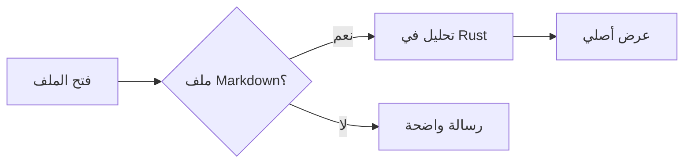
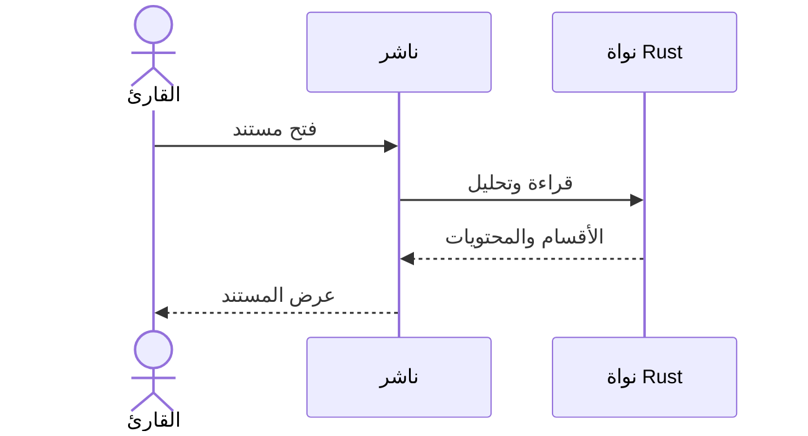
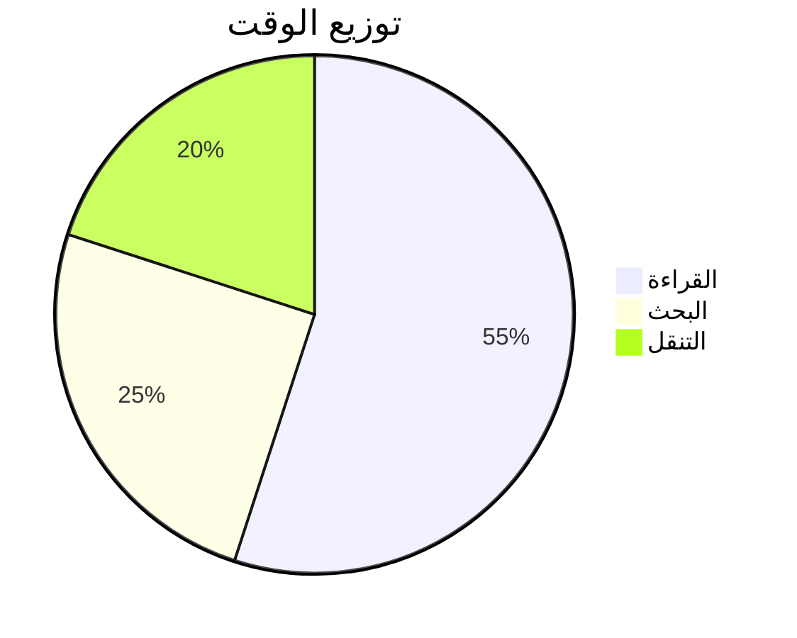

# مرحباً بك في ناشر

**ناشر** قارئ Markdown أصلي وسريع، صُمّم ليمنح النصوص العربية والتقنية تجربة قراءة هادئة ومريحة. هذا المستند جولة قصيرة فيما يعرضه التطبيق؛ افتح الشريط الجانبي (`Ctrl + B`) لترى المحتويات، أو ابحث عن أي كلمة بـ `Ctrl + F`.

> [!TIP]
> اسحب أي ملف `.md` من مستكشف الملفات وأفلته في النافذة لفتحه في تبويب جديد.

## النص العربي والاتجاه

يكتشف ناشر اتجاه المستند تلقائياً، ويعرض كل فقرة باتجاهها الصحيح. يمكنك مزج العربية مع English داخل الفقرة نفسها، وكتابة مسارات مثل `C:\Users\docs\README.md` أو أرقام مثل 3.14 و٢٠٢٦ دون أن تنقلب علامات الترقيم.

This paragraph is written in English, so it reads left to right even inside an Arabic document.

### التنسيق

نص **عريض**، ونص *مائل*، ونص ~~مشطوب~~، و<mark>نص مميّز</mark>، و<kbd>Ctrl</kbd> + <kbd>F</kbd>، ورابط إلى [موقع NSH](https://nsh.dev).

## القوائم والمهام

1. افتح المستند.
2. تصفّح المحتويات:
   - العناوين الرئيسية
   - العناوين الفرعية
3. ابحث داخل النص.

- [x] دعم العربية وRTL
- [x] مخططات Mermaid
- [ ] تصدير PDF (قريباً)

## الجداول

| الميزة | الحالة | ملاحظات |
|---|:---:|---|
| عرض Markdown | ✅ | CommonMark وإضافات GitHub |
| البحث العربي | ✅ | يتجاهل التشكيل والهمزات |
| Mermaid | ✅ | عشرة أنواع من المخططات |
| Large files | ✅ | حتى 64 MB افتراضياً |

## الأكواد البرمجية

```rust
fn main() {
    // تعليق بالعربية داخل كود Rust
    let name = "ناشر";
    println!("مرحباً من {name}!");
}
```

```tsx
import { TextView } from "nsh/base";

export const Reader = (props: { markdown: string }) => (
  <TextView markdown={props.markdown} selectable />
);
```

## الصيغ الرياضية

معادلة داخل السطر: $E = mc^2$، ومعادلة مستقلة:

$$
\int_0^1 x^2\,dx = \frac{1}{3}
$$

## مخططات Mermaid







## الحواشي

يدعم ناشر الحواشي السفلية[^1] ويعرضها أسفل القسم الذي يشير إليها.

[^1]: هذه حاشية سفلية، وتظهر مع القسم الذي ذُكرت فيه.

## اختصارات مفيدة

| الاختصار | الوظيفة |
|---|---|
| <kbd>Ctrl</kbd> + <kbd>O</kbd> | فتح مستند |
| <kbd>Ctrl</kbd> + <kbd>F</kbd> | البحث |
| <kbd>Ctrl</kbd> + <kbd>B</kbd> | إظهار الشريط الجانبي |
| <kbd>Ctrl</kbd> + <kbd>+</kbd> / <kbd>-</kbd> | تكبير الخط وتصغيره |
| <kbd>Ctrl</kbd> + <kbd>Tab</kbd> | المستند التالي |
| <kbd>F11</kbd> | ملء الشاشة |

قراءة ممتعة! 📖
