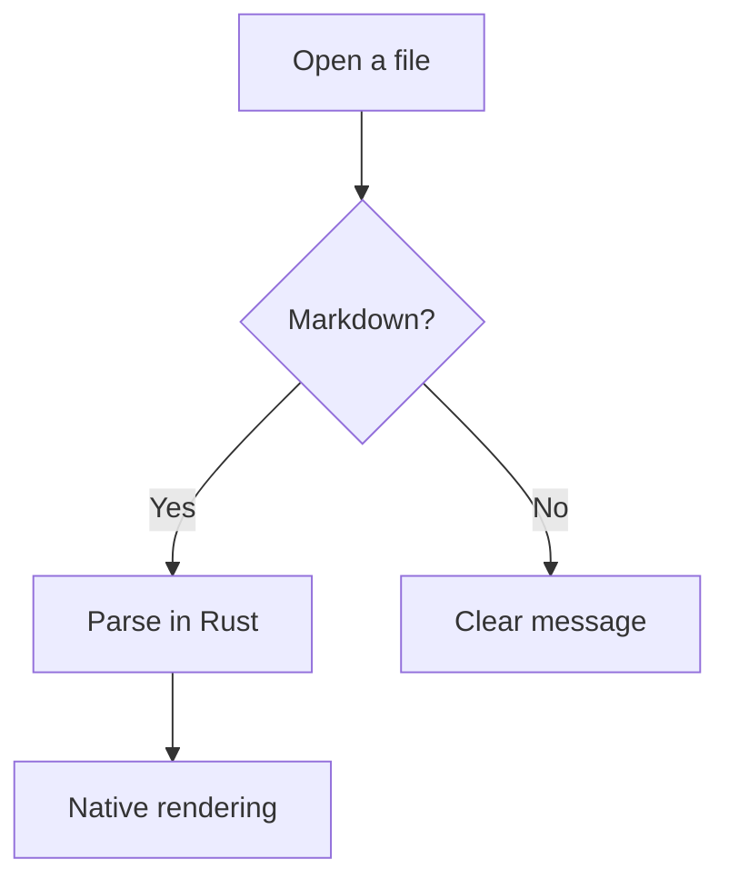
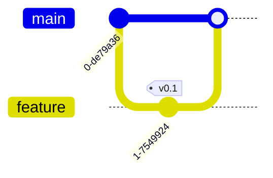

# Welcome to Nashir

**Nashir** (ناشر, *publisher*) is a fast, native Markdown reader with first-class Arabic and right-to-left support. This document is a short tour; open the sidebar (`Ctrl + B`) for the outline, or search with `Ctrl + F`.

> [!TIP]
> Drag any `.md` file from File Explorer onto the window to open it in a new tab.

## Mixed directions

Nashir detects each document's direction and lays out every paragraph in its own direction.

يُعرض هذا السطر العربي من اليمين إلى اليسار حتى داخل مستند إنجليزي.

Paths like `C:\Users\docs\README.md` and numbers like 3.14 stay intact.

## Formatting

**Bold**, *italic*, ~~struck~~, <mark>highlighted</mark>, <kbd>Ctrl</kbd> + <kbd>F</kbd>, and a link to [NSH](https://nsh.dev).

- [x] Arabic & RTL
- [x] Mermaid diagrams
- [ ] PDF export (planned)

| Feature | Status |
|---|:---:|
| Markdown | ✅ |
| Arabic-aware search | ✅ |
| Mermaid | ✅ |

```rust
fn main() {
    println!("Hello from Nashir!");
}
```

Inline math $a^2 + b^2 = c^2$ and a block:

$$
\sum_{n=1}^{\infty} \frac{1}{n^2} = \frac{\pi^2}{6}
$$

## Diagrams





Footnotes work too.[^note]

[^note]: Shown under the section that references them.

Happy reading! 📖
