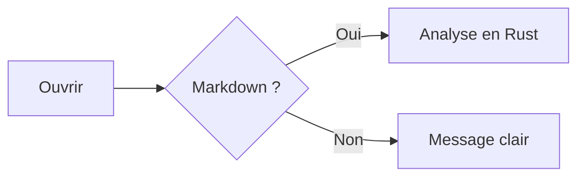

# Bienvenue dans Nashir

**Nashir** (ناشر, *éditeur*) est un lecteur Markdown natif et rapide, avec une excellente prise en charge de l'arabe et de l'écriture de droite à gauche. Ouvrez la barre latérale (`Ctrl + B`) pour la table des matières, ou cherchez avec `Ctrl + F`.

> [!TIP]
> Glissez un fichier `.md` depuis l'Explorateur sur la fenêtre pour l'ouvrir dans un nouvel onglet.

## Directions mixtes

Nashir détecte la direction de chaque document et affiche chaque paragraphe dans sa propre direction.

يُعرض هذا السطر العربي من اليمين إلى اليسار.

## Mise en forme

**Gras**, *italique*, ~~barré~~, <mark>surligné</mark> et un lien vers [NSH](https://nsh.dev).

| Fonction | État |
|---|:---:|
| Markdown | ✅ |
| Recherche arabe | ✅ |
| Mermaid | ✅ |

```python
print("Bonjour depuis Nashir !")
```

## Diagrammes



Bonne lecture ! 📖
