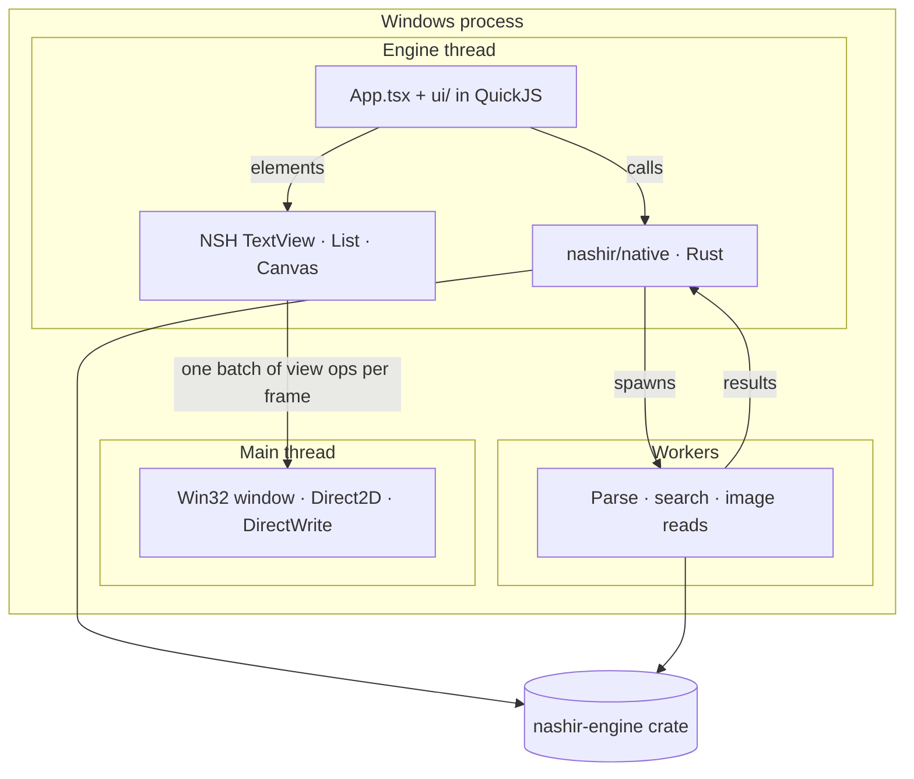

# Architecture

> **ملخص:** ناشر تطبيق NSH من جزأين: واجهة TSX تعمل على محرك NSH، ونواة Rust تُصدَّر إليها كوحدة أصلية. المستند يبقى في Rust، والواجهة تطلب كل قسم عند ظهوره فقط.

Nashir is a **mixed NSH app**: a TSX interface (`app/App.tsx`, `app/ui/`) running on NSH's engine, and a Rust crate (`app/native`) that NSH links into the app and exposes to TSX as the module `nashir/native`. The crate is a thin layer over `crates/nashir-engine`, a plain Rust library with no NSH dependency.

## Layers

| Layer | Where | Responsibility |
|---|---|---|
| Interface | `app/App.tsx`, `app/ui/*.tsx` | Window, title bar, tabs, sidebar, reader, search, settings, dialogs; all state in NSH signals. |
| Bridge | `app/ui/native.ts` | Typed wrappers that parse the JSON the native module returns. Nothing else in the UI touches `nashir/native`. |
| Native module | `app/native/src` | `Library` (documents), `Diagrams` (Mermaid), `Desktop` (dialogs, launch arguments, reveal/open). Owns open documents. |
| Engine | `crates/nashir-engine` | Loading and validation, sectioning, outline/anchors, direction detection, Arabic-aware search and highlighting, Mermaid parsing/layout/SVG. Pure Rust, unit-tested and benchmarked. |

## Why the document stays in Rust

TSX runs in QuickJS, an interpreter. Copying a 50 MB string into it, parsing Markdown there, or searching it would be slow and memory-hungry. Instead:

1. `Library.open(path)` reads, validates, decodes and **sections** the file on a worker thread, then keeps the `Document` in a Rust map and returns only metadata (outline, stats, one direction letter per section).
2. The reader is an NSH `List` — virtualized and recycling — with one row per section. A row calls `Library.section(id, index)` when it is shown and renders the Markdown with NSH's native `TextView`.
3. Search runs in Rust (`Library.search`) on a worker thread; rows that contain matches ask for `Library.highlighted(...)` instead, which wraps matches in `<mark>` outside code and link targets.

So the interface's heap holds metadata and the few sections on screen, whatever the document's size. See [Markdown rendering](markdown-rendering.md).

## Threads

| Thread | Runs |
|---|---|
| Main (UI) | NSH's platform backend: Win32 messages, Direct2D drawing, DirectWrite text, input. Never waits for app code. |
| Engine | QuickJS with the TSX app, NSH's reactive graph, layout (Taffy), native module calls that are not `async`. |
| Workers | `util::background` threads for file reading/parsing, search and image reads; results come back through `async` module functions as Promises. |

Synchronous native calls (`section`, `highlighted`, `layout`) are cheap: a section is at most ~24 KB (≈96 KB inside a giant code block), and diagrams are capped at 64 KB of source.

## State

All interface state lives in signals in `app/ui/state.ts` (settings, tabs, recent files, bookmarks, toasts) and `app/ui/search.ts`. Scroll positions are deliberately **not** reactive: they change on every scroll and would otherwise re-render the tab strip and search bar. Persistence uses NSH's `Storage` with a debounce ([Settings & storage](settings-and-storage.md)).

Views that must be re-created when the active document changes are keyed with `Each` over a one-element list (`[key]`), which gives a clean lifecycle per document (reader, sidebar, search bar).

## Start-up

`App.tsx` mounts the app, then `start()`:

1. loads persisted state (`loadPersisted`);
2. reopens the previous session's tabs (pinned first) if enabled;
3. opens files passed on the command line (`Desktop.launchPaths()` — file association / "Open with");
4. on a first run with nothing to open, opens the built-in welcome tour (`Library.openWelcome`);
5. starts the 2-second change watcher (`Library.changed`).

## Error handling

Native errors cross as stable codes (`not_found`, `too_large:<bytes>:<max>`, …) decoded in `native.ts` into `OpenError` and translated in the UI. A failed tab shows a dedicated screen with *Try again* and *Close*; unsupported diagrams show a message with their source; transient issues use toasts. Nothing throws past a component.
