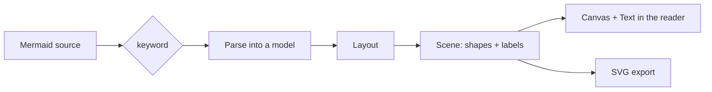

# Mermaid rendering

> **ملخص:** لا يستخدم ناشر مكتبة mermaid.js ولا متصفحاً؛ محرك Rust يحلل المخطط ويرتبه ويحوّله إلى «مشهد» من أشكال ونصوص، تُرسم الأشكال على Canvas والنصوص بمكوّن Text الأصلي فيظهر العربي صحيحاً.

## Why a native engine

Mermaid's reference implementation is JavaScript that needs a browser DOM to measure and draw text. Nashir has no browser engine by design (no Electron, no web view for content), and NSH's TSX runtime (QuickJS) has no DOM. The options were:

| Option | Verdict |
|---|---|
| mermaid.js in a `WebView` | Rejected: a browser inside the app, ~2 MB of JS, slower start, against the "no browser-based" requirement. |
| Render to SVG and show as `Image` | Rejected for display: NSH's native SVG renderer (resvg) does not draw `<text>`, so labels would vanish. |
| **Rust layout → native shapes + native text** | **Chosen**: small, fast, offline, and Arabic labels are shaped by DirectWrite like the rest of the app. |

## Pipeline

- **Scene** (`mermaid::scene`): `shapes` are SVG path data with fill/stroke **color tokens**; `labels` are boxes with text, size, weight, alignment and direction (from the first strong character).
- **Interface** (`app/ui/MermaidView.tsx`): draws shapes on a `Canvas` with `Path2D`, places each label as an absolutely positioned native `Text` (selectable, readable by screen readers), and resolves tokens with the theme's palette — so diagrams follow light/paper/dark.
- **Export** (`mermaid::svg`): the same scene as SVG with `<text>` elements (`direction="rtl"` where needed), light or dark palette.

## Supported diagrams

| Keyword | Supported syntax |
|---|---|
| `flowchart` / `graph` (TB, TD, BT, LR, RL) | Node shapes `[ ]` `( )` `([ ])` `[[ ]]` `[( )]` `(( ))` `((( )))` `{ }` `{{ }}` `[/ /]` `[\ \]` `[/ \]` `[\ /]` `> ]`; quoted labels; ` `; links `-->` `---` `-.->` `==>` `~~~`, `x`/`o` ends, `<-->`; labels `-->|text|` and `-- text -->`; chains and `&`; `subgraph … end` (drawn as clusters); `;` separators. `classDef`, `style`, `click` are ignored. |
| `sequenceDiagram` | `participant`/`actor` with `as`; `->>` `-->>` `->` `-->` `-x` `--x` `-)` `--)`; `autonumber`; notes left/right/over; `loop` `alt`/`else` `opt` `par`/`and` `critical`/`option` `break` `rect`; `title`. |
| `classDiagram` | `class X`, `class X { … }`, `X : member`, generics `~T~`, annotations `<<interface>>`, relations `<\|--` `*--` `o--` `-->` `..>` `..\|>` `--` `..` (both directions), cardinalities, labels. |
| `stateDiagram` / `-v2` | Transitions with labels, `[*]` start/end per scope, `state "…" as X`, descriptions, composite states (clusters), `<<fork>>` `<<join>>` `<<choice>>`, `direction`. |
| `erDiagram` | Entities with attribute blocks (type, name, keys, comment), relations `\|\|` `\|o` `}\|` `}o` with `--`/`..`, labels; cardinalities shown as `1`, `0..1`, `1..*`, `0..*`. |
| `gantt` | `title`, `dateFormat` (YYYY-MM-DD), `section`, tasks with `done`/`active`/`crit`/`milestone`, ids, `after id`, end dates or durations (`d`, `w`, `h`). |
| `pie` | `title`, `showData`, `"label" : value`. |
| `mindmap` | Indentation tree, shapes `(( ))` `[ ]` `( )` `)) ((` `{{ }}`, branches colored and split left/right. |
| `gitGraph` | `commit` (`id`, `tag`, `type: HIGHLIGHT`), `branch`, `checkout`/`switch`, `merge`, `cherry-pick`, TB/LR. |
| `journey` | `title`, `section`, `Task: score: actors`. |

Anything else (e.g. `quadrantChart`, `sankey-beta`) shows a clear message with the source and a copy button. Front matter (`---`) and `%%` comments are skipped. Sources over 64 KB are refused.

## Layout

Graph-like diagrams use a compact layered (Sugiyama-style) layout (`mermaid::layout`): DFS cycle breaking, longest-path ranking with sources pulled toward their children, 8 barycenter sweeps to reduce crossings, then coordinates where each node moves toward its neighbours' mean while keeping order and spacing. Edges are cubic Béziers; back edges curve around the outside; self-loops are drawn beside the node. Sequence, Gantt, pie, journey, mindmap and gitGraph have dedicated layouts.

Text is measured with per-script width estimates (Arabic diacritics count zero); the interface then lays each label out natively inside its box, so estimates only need to be slightly generous.

## Interaction

- Zoom 50–300% (toolbar), redrawn crisply at each zoom (not scaled bitmaps).
- Horizontal scrolling inline; **Expand** opens a dialog with two-axis panning and its own zoom.
- **Copy source** and **Export SVG** (in the current theme's palette).

## Limitations

Styling directives (`classDef`, `style`, `linkStyle`), click handlers, icons, markdown strings and the newest syntaxes (e.g. `flowchart` `@{ shape: … }`) are parsed but not applied. PNG export is planned ([roadmap](roadmap.md)).
